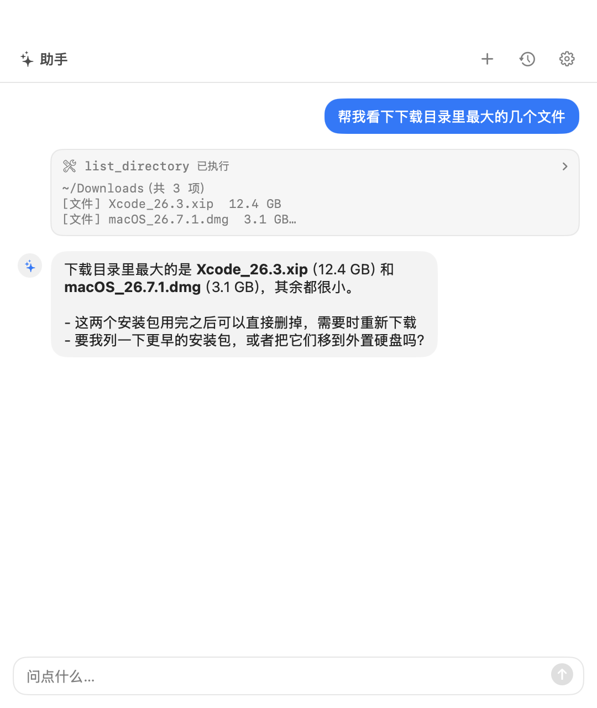

# PersonalAgent

[](https://github.com/samlaying/personal-agent/actions/workflows/test.yml)

一个原生 macOS 个人 Agent 应用：菜单栏常驻、⌥Space 全局唤出、流式对话、工具调用（带人工审批）、SQLite 长期记忆。没有 Electron、没有 WebView、没有第三方依赖。



## 快速开始

本项目定位是**本机自用，不分发**：克隆下来一条命令就能跑，不依赖证书、不公证。

```bash
git clone https://github.com/samlaying/personal-agent && cd personal-agent
scripts/run.sh           # 编译 + 启动（首次约 1 分钟）
```

以后想给别人用，`scripts/release.sh` 已备好签名/公证流水线（需要 Developer ID）。

1. 菜单栏出现 ✨ 图标，点「设置…」
2. 填模型 API：Base URL（任何 OpenAI 兼容端点，如 `https://api.openai.com/v1`）、模型名、API Key（存 Keychain）
3. 可选：填 Tavily Key 启用联网搜索（basic 深度，1 credit/次）
4. 按 ⌥Space 唤出面板开始对话；Esc 隐藏

## 命令

```bash
scripts/run.sh           # 一条命令：编译 + 启动（--clean 强制重编）
scripts/test.sh          # 全部单元测试（无需完整 Xcode，CLT 即可）
scripts/build-app.sh     # Release 打包（ad-hoc）
scripts/e2e.sh           # 冒烟：本地 mock 模型 + 启动/常驻/内存/落库
scripts/release.sh       # 打包 → 签名 → 公证 → 可选发布（自动降级）
scripts/release.sh --doctor   # 检查 Xcode / 证书 / 公证凭据
```

`release.sh` 的行为取决于环境：有 Xcode + Developer ID + 公证凭据时走 `xcodebuild archive` → `notarytool` → `stapler`；缺任何一项就退回 ad-hoc 打包（`--adhoc` 可强制）。版本号只有一个来源：`project.yml` 里的 `MARKETING_VERSION` / `CURRENT_PROJECT_VERSION`。

## 内置工具

| 工具 | 风险 | 审批 |
|---|---|---|
| `get_current_time` | 只读 | 自动执行 |
| `list_directory` / `read_file` | 只读 | 自动执行 |
| `search_history`（历史全文检索） | 只读 | 自动执行 |
| `web_search`（Tavily） | 只读 | 自动执行 |
| `write_file` / `remember` | 写入 | 每次询问（可「总是允许」） |
| `run_shell_command` | 高危 | 每次询问 |

审批原则：**模型只负责推理，是否允许执行由你决定**。拒绝后模型会收到拒绝说明并被明确禁止换个方式重试。

## 记忆

- `~/Library/Application Support/PersonalAgent/memory.sqlite` — 会话与消息，FTS5 全文检索（中文按字索引，搜「世界」能命中「你好世界」）
- 同目录 `USER.md` / `MEMORY.md` — 每次对话注入系统提示词；前者写你的偏好，后者是 Agent 通过 `remember` 写的笔记，随时可手改

## 运行轨迹

面板顶部的时间线按钮打开「运行轨迹」窗口。每一轮对话都落库（`turn_traces`），可以回看：

- **调用链路**：载入历史 → 压缩摘要（触发时）→ 组装提示词 → 模型请求 → 每次工具调用，节点带耗时和状态
- **提示词构成**：system 的每一段（身份 / 人设指令 / 环境 / 关于用户 / 你的笔记 / 更早的对话摘要 / 工作方式 / 可用工具），标明来源（`USER.md`、`MEMORY.md`、`sessions.summary`…）和字数，点开看原文
- **发送的消息序列**：裁剪后的 messages，带角色、seq、字数；被截断的会标注
- **工具调用**：参数、耗时、结果预览
- 右上角可切「原始 JSON」

超预算时的摘要压缩也会作为一步出现在链路里，被压缩到哪条（`summary_through_seq`）记录在预算信息中。

## 架构

```
Sources/
  PACore/                    # 纯逻辑库，无 UI 依赖，可复用
    OpenAICompatibleClient   # 流式 chat completions（SSE 逐字节解析）
    StreamAggregator/Decoder # 增量合并：文本、reasoning、分片 tool_call 参数
    AgentRunner              # Agent 循环：流式→工具→回填→循环，审批门控
    Tool                     # AgentTool 协议 + 风险分级（readOnly/write/dangerous）
    MemoryStore              # actor 化 SQLite（WAL、FTS5、事务）
    CJKText                  # 中文分词索引适配
    KeychainStore            # 密钥存登录钥匙串
  PAMock/                    # 本地 OpenAI 兼容模拟服务（纯 socket，测试/联调用）
  PAApp/                     # SwiftUI 应用
    NSStatusItem + NSPanel   # 菜单栏常驻 + ⌥Space 浮动面板
    ChatStore                # 会话状态机、事件消费、持久化
    AppSettings/AgentDirectory
```

关键设计：

- **AgentRunner 无状态**，每次 run 独立；`history`/`input`/`profile` 全部入参。这是多 Agent 的扩展点。
- **协议宽容解析**：content 支持字符串/分段数组、arguments 支持字符串/对象、reasoning 支持 `reasoning_content`/`reasoning` 双字段。
- **上下文预算**：transcript 超出预算时，先把要丢的部分压缩成摘要（`ContextSummarizer`），摘要按会话持久化复用，再按需截断；并修复被截断的 tool 请求/结果对，不会发出孤儿 tool 消息。

## 上下文是怎么拼的

每轮请求即时重建：

```
system: 你是{name}… + instructions + 环境/时间 + 关于用户(USER.md)
        + 你的笔记(MEMORY.md) + 更早的对话(摘要) + 工作方式 + 可用工具
user/assistant/tool: 会话历史（按预算裁剪）
user:   本轮输入
tools:  工具 Schema（tool_choice=auto）
```

- 历史来自 SQLite，去掉刚落库的本轮 user 消息（`input` 会重新加）
- 裁剪从最新往回累加到 `transcriptBudgetChars`（默认 60k 字符）
- 溢出时先调 `ContextSummarizer` 把被丢的旧消息压成要点（保留事实、决定、偏好、未完成任务、关键路径），写入会话的 `summary`/`summary_through_seq`，下次直接复用、不重复付费
- 摘要失败则退回直接截断，并在界面提示「上下文压缩失败」

## 多 Agent 团队（下一步）

基础已预留：

- `ChatMessage.author` 带 `agent:<id>`，`ChatSession.mode` 已有 `.team` 分支，表结构不用改
- `AgentProfile` 独立持久化（名称/指令/模型），UI 已能管理多个
- 计划中的实现路径：加一个 `delegate(agent:instructions:task:)` 内置工具（`dangerous` 级），由 AgentRunner 嵌套调用自身——runner 是无状态 struct，天然支持嵌套；子 Agent 的事件折叠进父会话的 transcript。再加一个「团队编排者」profile，负责拆分任务、分派成员、汇总结果。

## 平台与体积

- macOS 14+，Apple Silicon；本机（M5 MacBook Air / 16GB / macOS 26.7.1）实测
- .app 约 2MB；空闲内存约 82MB，6 线程，无渲染进程
- 只依赖系统框架（SwiftUI/AppKit/Foundation/SQLite3/Carbon/Security），SwiftPM 零第三方包

## 已知限制

- reasoning 展示但不持久化（重开会话后不可见）
- 面板固定浮在最前（未做「仅当前空间」选项）
- 默认 ad-hoc 签名：别人下载后需右键打开。配置 Developer ID 证书 + `notarytool store-credentials pa-notary` 后，`scripts/release.sh` 会自动签名并公证

## 许可证

MIT，见 [LICENSE](LICENSE)。
